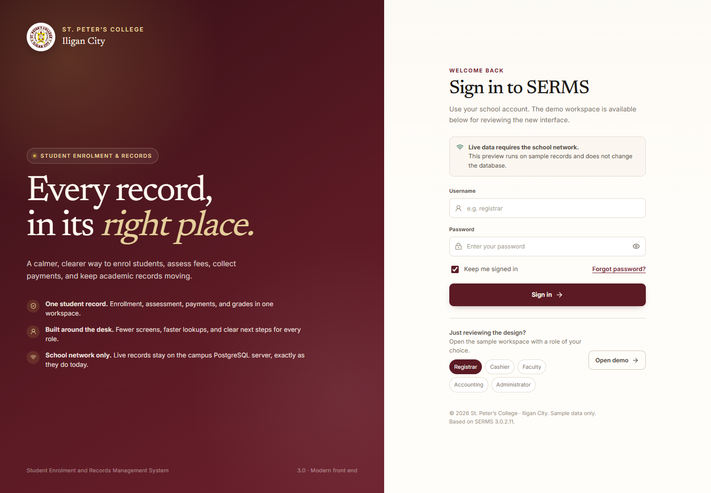

# SERMS Modern

A clean, modern front end for the **Student Enrolment and Records Management System** of St. Peter's College — Iligan City.

This folder is a working interface prototype built from the shipped SERMS 3.0.2.11 application. It keeps the school's maroon-and-gold identity, reorganises the old module/menu structure around the student record, and runs as a Windows desktop shell.



## Run it

### Desktop app

From a fresh clone:

```powershell
Copy-Item config\srgb.example.ini config\srgb.ini
npm install
npm run build
npx electron-builder --win dir --x64
.\SERMS Modern.cmd
```

The launcher uses the installed Electron runtime to load the bundled `release/win-unpacked/resources/app.asar`. The generated unsigned `.exe` may be blocked by Windows Application Control; the launcher is the reliable local path. `SERMS Modern.lnk` is a machine-local shortcut and is intentionally not committed.

### Browser development

```powershell
Copy-Item config\srgb.example.ini config\srgb.ini
npm install
npm run dev
```

`config/srgb.ini` is intentionally ignored because it points at the school's internal server.

### Rebuild

```powershell
npm run build            # TypeScript + Vite
npm run test:smoke       # Edge + Playwright smoke test
npm run electron:build   # portable target; use --win dir if the 7z step is blocked
```

## What is in the prototype

- Login with a school PostgreSQL account for live records, or **Open demo** for synthetic data; responsive app shell.
- Role-aware navigation: Registrar, Cashier, Faculty, Accounting, Administrator.
- Dashboard with enrollment pulse, outstanding balances, collections, checklist, activity.
- Student directory with search, status/program filters, add/edit student, CSV export, and a consolidated student workspace:
  - Overview
  - Enrollment / COR (add or remove subjects)
  - Assessment
  - Payments
  - Grades
  - Documents
- Registration desk with queue, student selection, and open sections.
- Cashier desk with receipts, receipt lookup, balances, and a working payment flow with OR preview.
- Printable COR, assessment, statement of account, and TOR previews from the student workspace (screen + print CSS).
- Academics desk with grade sheets, faculty load, Dean's List, and a grade-entry sheet.
- Report library with categories, favourites, and recent reports.
- Administration with term, fees, access, receipt ranges, audit, and a live **school server connection test**.
- Command palette (`Ctrl+K`) searches students, OR numbers/receipts, pages, and actions, with keyboard focus traps, reduced-motion support, and mobile layouts with no horizontal page overflow.
- Graphify context graph for the app source: `docs/graphify/GRAPH_REPORT.md`.

## Live database

The original app talks directly to PostgreSQL at `192.168.8.10:5432/dbspc`, configured by `srgb.ini`. It has no separate grade-upload service: the grade sheet writes grade components to `srgb.registration` on the school server, which is why it only works on the school network.

This prototype follows the same direction:

- It reads `srgb.ini` from the app folder / resources.
- Administration → **Test connection** opens a real PostgreSQL connection with a school account. It reports the server and database, then reads the current term plus student/enrolled counts, or shows a clear network/sign-in error.
- **Open live records** after a successful test loads the current term, student directory, COR/enrollment, assessment fee lines, payments, GPA, and balances. Overview, Students, and a read-only Cashier remain available. Payment posting and student edits are disabled; per-student and class-level grade entry are available from the Grades tab behind an explicit live-write confirmation.
- No API server or new upload service is introduced.
- The demo screens use synthetic records. The live preview loads real records and is deliberately restricted to the student directory/workspace plus the read-only cashier. Grade entry writes only the four raw components to `srgb.registration` after confirmation; the database trigger computes the cumulative grade. Payment/assessment writes are still the next phase and must be validated on the school network before any real financial records are changed.

See `docs/LIVE-DATA.md` for the planned mapping and the areas that must not be guessed.

## Current coverage vs. the original

The original has 146 business forms, 15 role menus, 110 tables, and 205 database functions. This prototype covers the daily student/registration/cashier/academic loop. It does **not** claim one-for-one parity with every administrative form or report yet. The remaining gap is tracked in `docs/LIVE-DATA.md`.

## Safety notes

- All visible demo records are synthetic.
- No production data is included in this folder.
- Do not commit `srgb.ini` credentials, student records, or the database dump.
- The original binary contains a hard-coded FTP account for student photos. The modern app does not reuse that credential; photo upload will be moved to configuration before it is wired.
- The generated Windows executable is unsigned; Windows Application Control may block it. Use the launcher on this machine, or sign the build for broader distribution.
